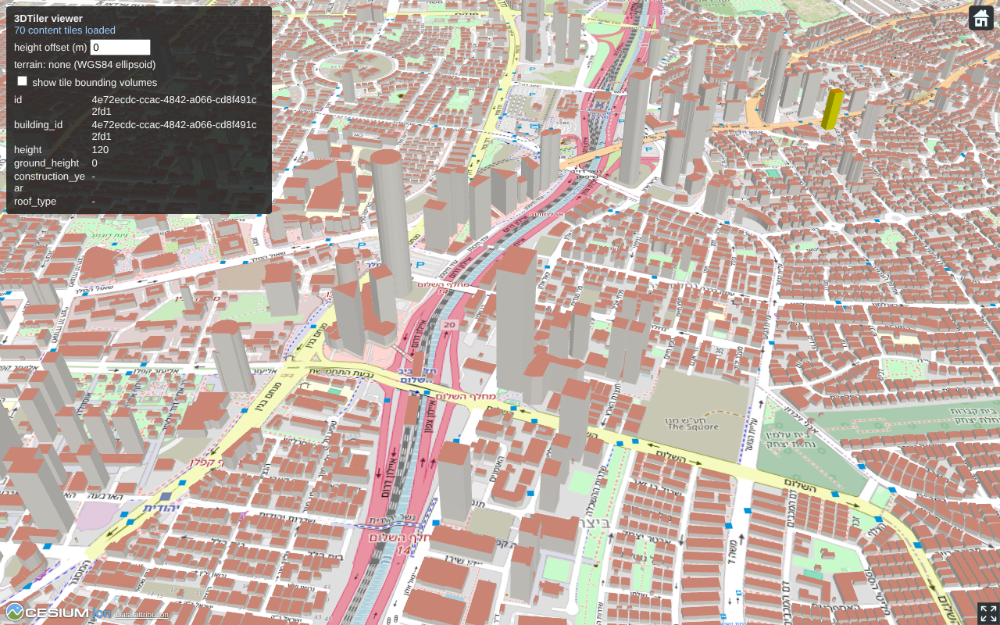
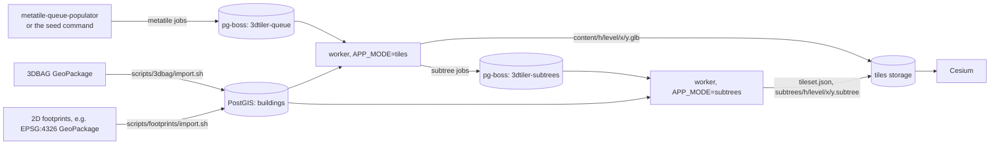

# 3DTiler

A worker that turns 3D buildings stored in PostGIS into a world-wide [3D Tiles 1.1](https://docs.ogc.org/cs/22-025r4/22-025r4.html) tileset: implicit quadtree tiling, GLB content with per-building feature ids (`EXT_mesh_features`) and properties (`EXT_structural_metadata`), ready to stream in Cesium.

It follows [retiler](https://github.com/MapColonies/retiler): it consumes metatile jobs from a [pg-boss](https://github.com/timgit/pg-boss) queue filled by metatile-queue-populator, and writes tiles to storage. The design is in [docs/osm-3d-tiles-plan.md](docs/osm-3d-tiles-plan.md), and the milestones are in [docs/execution-plan.md](docs/execution-plan.md).



It takes two kinds of input, both stored in the same table in EPSG:4326: full 3D buildings (3DBAG, LoD 2.2), and 2D footprints with a height (any OGR file and CRS, e.g. Overture Maps or OpenStreetMap buildings), which are extruded at import.

## How it works



- **Grid.** The world is two implicit quadtrees, one per hemisphere, whose roots are the two level 0 tiles of WorldCRS84Quad. An implicit level is the same as a WorldCRS84Quad zoom level, so the jobs of metatile-queue-populator and `@map-colonies/tile-calc` work without changes. Implicit tiling counts y from the south, so y is flipped.
- **Content levels.** Every building is stored in exactly one tile, at one of the content levels (z14 for buildings at least 15 m high or 500 m² in area, z15 for the rest). Refinement is `ADD`, so the other levels have no content.
- **Jobs.** A job `{z, x, y, metatile}` covers `metatile × metatile` tiles at zoom `z`, which is one tile at `z − log2(metatile)`. With a metatile of 8, a z16 job covers one z13 tile: 4 z14 and 16 z15 content tiles. The worker builds them one at a time, writes the non-empty ones, deletes the empty ones, and queues the rebuild of the subtrees that hold them.
- **Coordinates.** Each content tile has a local east-north-up frame at its center. Vertex positions are small float32 offsets in meters, and the GLB root node matrix (float64) places the tile on the globe.
- **Subtrees.** Subtree availability is rebuilt from the buildings table. The subtree queue uses the pg-boss `stately` policy, keyed by subtree, so many tile jobs of the same subtree cause a single rebuild.

## Quick start: docker compose

```bash
docker compose up --build
```

Then open http://localhost:8080. Compose starts:

| Service          | What it does                                                                                                      |
| ---------------- | ----------------------------------------------------------------------------------------------------------------- |
| `postgis`        | PostGIS 16 with `postgis_sfcgal`                                                                                  |
| `import-3dbag`   | Downloads the 3DBAG tiles in `TILE_IDS` and the Dutch PROJ grids, and imports them into `buildings`               |
| `import-footprints` | Only with `--profile footprints`: imports the footprint file `./data/$FOOTPRINTS_FILE`                         |
| `seed`           | Stands in for metatile-queue-populator: queues one job per metatile area that has buildings                       |
| `tiler-tiles`    | The worker in `tiles` mode                                                                                         |
| `tiler-subtrees` | The worker in `subtrees` mode, it also writes `tileset.json`                                                       |
| `viewer`         | nginx serving the Cesium viewer and the tileset                                                                    |

Compose settings (environment variables or an `.env` file):

| Variable                          | Default         | Description                                                    |
| --------------------------------- | --------------- | -------------------------------------------------------------- |
| `TILE_IDS`                        | `8-688-40`      | Space separated 3DBAG tile ids, from https://3dbag.nl/en/download. Empty imports none |
| `FOOTPRINTS_FILE`                 | `buildings.gpkg` | The footprint file in `./data`, with `--profile footprints`   |
| `GROUND_HEIGHT`                   | `0`             | The ellipsoidal ground height given to extruded footprints     |
| `BAG3D_VERSION`                   | `v20250903`     | The 3DBAG release                                              |
| `GEOMETRY_BUILDER`                | `node`          | `node` or `postgis`, see [Geometry builders](#geometry-builders) |
| `METATILE_ZOOM` / `METATILE_SIZE` | `16` / `8`      | The seeded job shape                                           |
| `VIEWER_PORT` / `POSTGIS_PORT`    | `8080` / `5432` | Host ports                                                     |

To process new data, import it and run the seed again:

```bash
TILE_IDS="8-688-40 8-688-48" docker compose up import-3dbag seed
```

To tile Tel Aviv from Overture Maps instead (EPSG:4326 footprints), extract it (see [Importing 2D footprints](#importing-2d-footprints)) into `./data`, then:

```bash
FOOTPRINTS_FILE=tel-aviv-buildings.gpkg TILE_IDS= docker compose --profile footprints up --build
```

and open http://localhost:8080/?lon=34.795&lat=32.075&range=1800.

### The viewer

The viewer (`viewer/index.html`) uses CesiumJS with OpenStreetMap imagery, and needs no Cesium ion account. Click a building to see its properties. Query parameters:

| Parameter              | Description                                                                                                    |
| ---------------------- | -------------------------------------------------------------------------------------------------------------- |
| `lon`, `lat`, `range`  | The camera target and distance (defaults to the 3DBAG sample in Valkenburg, use `?lon=34.795&lat=32.075&range=1800` for Tel Aviv) |
| `heightOffset`         | Moves the tileset up or down, in meters                                                                        |
| `ionToken`             | A Cesium ion token, to use Cesium World Terrain                                                                |
| `tileset`              | The tileset URL (defaults to `tiles/tileset.json`)                                                             |

Buildings stand at their real ellipsoidal height. Without terrain the globe is the bare WGS84 ellipsoid at 0 m, so 3DBAG buildings float above it by the height of the ground, about 115 to 175 m in Valkenburg. Use `?heightOffset=-120` to put them roughly on the map, or `?ionToken=...` to see them on Cesium World Terrain. Extruded footprints use `GROUND_HEIGHT` (0 by default), so they sit on the ellipsoid and show correctly without terrain, but not on a terrain.

## The buildings table

The worker reads one table (`scripts/buildings.sql`), one row per building part. Every source is loaded into it in **EPSG:4326, with Z as the height in meters above the WGS84 ellipsoid**:

| Column                         | Type                            | Description                                                  |
| ------------------------------ | ------------------------------- | ------------------------------------------------------------ |
| `id`                           | `text`                          | The building part id                                         |
| `building_id`                  | `text`                          | The building id in the source                                |
| `source`                       | `text`                          | e.g. `3dbag`                                                 |
| `geom`                         | `geometry(MultiPolygonZ, 4326)` | The faces of the building (walls, roofs, ground), wound outwards |
| `face_labels`                  | `smallint[]`                    | The label of every face: 0 ground, 1 roof, 2 wall            |
| `ground_height`, `height`      | `real`                          | The lowest Z, and the height from it to the top              |
| `footprint_area`, `construction_year`, `roof_type` | | Attributes copied into the tiles                              |
| `tile_z`, `tile_x`, `tile_y`   | `smallint`, `integer`           | The content tile, WorldCRS84Quad with y from the north (indexed) |

### Importing 3DBAG

`scripts/3dbag/import.sh` loads 3DBAG GeoPackages with `ogr2ogr`. It converts EPSG:7415 (RD New + NAP) to EPSG:4979 and assigns the content tiles:

```bash
PGHOST=localhost PGUSER=postgres PGDATABASE=postgres ./scripts/3dbag/import.sh 8-688-40.gpkg
```

The conversion needs the PROJ grids `nl_nsgi_rdtrans2018.tif` and `nl_nsgi_nlgeo2018.tif` from https://cdn.proj.org. Without the geoid grid, PROJ silently keeps NAP heights, and buildings end up about 43 m too low. The script checks a known point first and stops if the grids are missing.

### Importing 2D footprints

`scripts/footprints/import.sh` loads any footprint file `ogr2ogr` reads, in any CRS (converted to EPSG:4326). It then extrudes every polygon in SQL into a ground face, a roof face and one wall per edge, holes included, so footprints go through the same worker as 3DBAG:

```bash
PGHOST=localhost PGUSER=postgres PGDATABASE=postgres SOURCE=overture ./scripts/footprints/import.sh tel-aviv-buildings.gpkg buildings
```

The attributes are mapped with SQL expressions over the source row `f`. The defaults fit Overture Maps:

| Variable                            | Default                                                    |
| ----------------------------------- | ---------------------------------------------------------- |
| `ID_EXPR`                           | `f.id`                                                     |
| `HEIGHT_EXPR`                       | `coalesce(f.height, f.num_floors * $FLOOR_HEIGHT, $DEFAULT_HEIGHT)`, with 3 m and 9 m |
| `MIN_HEIGHT_EXPR`                   | `f.min_height` (where a building part starts)              |
| `ROOF_TYPE_EXPR`                    | `f.roof_shape`                                             |
| `GROUND_HEIGHT`                     | `0`, the ellipsoidal height of the ground for every building |
| `SOURCE`                            | `footprints`                                               |

`GROUND_HEIGHT` is a single value until a DEM is sampled per building, which is the open terrain question.

#### Getting EPSG:4326 buildings from Overture Maps

[Overture Maps](https://overturemaps.org) publishes worldwide buildings in EPSG:4326 under ODbL (OpenStreetMap, Microsoft and Google footprints), with `height` and `num_floors` where known. `scripts/overture/extract_buildings.py` cuts a bounding box into a GeoPackage:

```bash
pip install duckdb
python scripts/overture/extract_buildings.py --bbox 34.74,32.04,34.82,32.12 data/tel-aviv-buildings.gpkg
```

That box holds 31,281 buildings (91% from OpenStreetMap). Only about 13% have a height or a number of floors, so most get the default height.

## Geometry builders

`app.tiling.geometryBuilder` (`TILING_GEOMETRY_BUILDER`) chooses where meshes are built. Both builders produce the same mesh: an integration test compares them within a millimeter.

| Builder          | How                                                                                                                                                              | Needs                                     |
| ---------------- | ---------------------------------------------------------------------------------------------------------------------------------------------------------------- | ----------------------------------------- |
| `node` (default) | PostGIS returns the faces as WKB. The worker converts them to the tile frame and triangulates them with earcut. Degenerate faces are skipped.                      | PostGIS                                   |
| `postgis`        | SFCGAL tesselates every face, and `ST_TransformPipeline` converts it to the tile frame. The worker only collects the triangles. Faces SFCGAL rejects are skipped. | PostGIS 3.4+ with `postgis_sfcgal`, PROJ 6+ |

The `postgis` builder moves the CPU work to the database, which pg-boss and other readers also use. Its GLBs are also larger (about 1.6 times on the 3DBAG sample), because SFCGAL returns separate triangles, so vertices are not shared within a face.

## Configuration

Configuration comes from `config/*.json` and environment variables, validated against a local schema (`src/common/configSchema.ts`) in offline mode.

| Environment variable                                | Config path                       | Default                     |
| --------------------------------------------------- | --------------------------------- | --------------------------- |
| `APP_MODE`                                          | `app.mode`                        | `tiles` (or `subtrees`)     |
| `QUEUE_NAME`                                        | `app.queueName`                   | `3dtiler-queue`             |
| `SUBTREES_QUEUE_NAME`                               | `app.subtrees.queueName`          | `3dtiler-subtrees`          |
| `APP_PARALLELISM`                                   | `app.parallelism`                 | `1`                         |
| `QUEUE_WAIT_TIMEOUT`                                | `app.jobQueue.waitTimeout`        | `5000` ms                   |
| `PGBOSS_HOST`, `PGBOSS_PORT`, `PGBOSS_USERNAME`, `PGBOSS_PASSWORD`, `PGBOSS_NAME`, `PGBOSS_SCHEMA` | `app.jobQueue.pgBoss.*` | `localhost`, `5432`, `postgres`, `postgres`, `postgres`, `pgboss` |
| `DB_HOST`, `DB_PORT`, `DB_USERNAME`, `DB_PASSWORD`, `DB_NAME`, `DB_SCHEMA` | `db.*` (the buildings table) | `localhost`, `5432`, `postgres`, `postgres`, `postgres`, `public` |
| `TILING_GEOMETRY_BUILDER`                           | `app.tiling.geometryBuilder`      | `node`                      |
| -                                                   | `app.tiling.contentLevels`        | `[14, 15]`                  |
| -                                                   | `app.tiling.subtreeLevels`        | `8`                         |
| -                                                   | `app.tiling.rootGeometricError`   | `800000` m                  |
| -                                                   | `app.tiling.minHeight`, `maxHeight` | `-500`, `6000` m          |
| `TILES_STORAGE_FS_BASE_PATH`                        | `app.tilesStorage.basePath`       | `./tiles`                   |
| `LOG_LEVEL`, `SERVER_PORT`                          | `telemetry.logger.level`, `server.port` | `info`, `8080`        |

The pg-boss database and the buildings database are configured separately, so they can be different databases. SSL for both is set with `PGBOSS_ENABLE_SSL_AUTH` / `DB_ENABLE_SSL_AUTH` and the matching CA, cert and key paths.

The worker serves `/liveness` (it checks pg-boss and the buildings database) and `/metrics` on `server.port`.

## Tileset layout

```
tileset.json                              static: an empty root with one implicit child per hemisphere
content/{h}/{level}/{x}/{y}.glb           h is 0 (west) or 1 (east), x and y are implicit tile indices
subtrees/{h}/{level}/{x}/{y}.subtree
```

## Development

Requires Node 24 and a PostGIS with `postgis_sfcgal` for the integration tests (`DB_HOST`, `DB_PORT` and so on, default `localhost:5432`):

```bash
npm install
docker compose up -d postgis
npm test
```

To run the worker locally:

```bash
npm run start:dev
```

To queue jobs for the imported buildings:

```bash
npm run build && cd dist && node --import ./instrumentation.mjs ./cli/seed.js --zoom 16 --metatile 8
```
