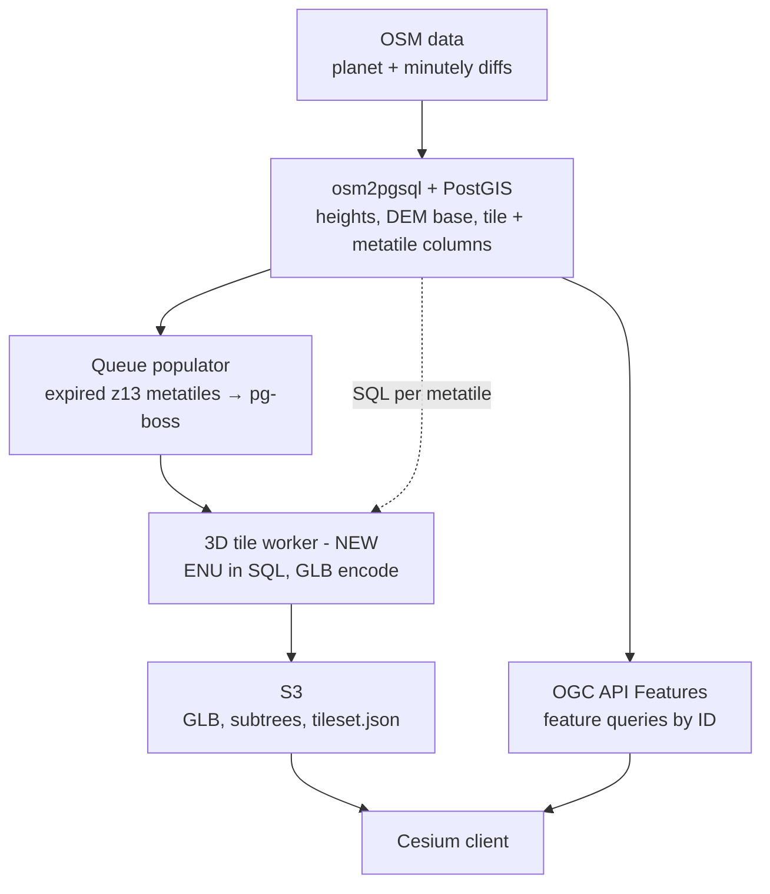

# OSM buildings → 3D Tiles: pipeline plan

A retiler-style pipeline that turns OSM buildings into a world-wide 3D Tiles 1.1 tileset, served from S3 and viewed in Cesium.

## Architecture



Reused: osm2pgsql, PostGIS, metatile-queue-populator, pg-boss, S3. New: the 3D tile worker and the subtree job.

## Key concepts

**Why not keep 4326.** glTF vertex positions are plain Cartesian meters. Degrees would be drawn as meters near the Earth's center. 3D Tiles requires geometry to end up in ECEF (EPSG:4978).

**Why not raw ECEF.** GLB stores positions as float32 (~7 significant digits). ECEF values are ~6,400,000 m, so vertices snap to a ~0.5 m grid and jitter.

**Why not UTM or EPSG:2039.** They are flat map projections, not ECEF, so Cesium can't use them directly. Their coordinates are still large, they ignore Earth curvature over long distances, and UTM has 60 zones. They are fine as input CRSs only.

**What we use: a local ENU frame per tile.** Each tile gets a tangent plane (east, north, up) at its center. Vertices are small offsets in meters, so float32 gives sub-millimeter precision. One float64 matrix places the tile on the globe. The tile frame has no EPSG code.

**Rule of thumb:** any CRS in the database, tile-local ENU inside the GLB, ECEF only in the transform matrix.

## Tiling scheme

- **One world root**, implicit quadtree. At level `z`, a tile spans `360/2^z` × `180/2^z` degrees.
- **y grows northward** (3D Tiles implicit tiling), the opposite of WMTS. Don't reuse retiler tile math unchanged.
- **Refinement `ADD`**: child content is drawn on top of the parent's, so each building is stored exactly once.
- **Content levels:**
  - z14 (~2.4 × 1.2 km at the equator): height ≥ 15 m or area ≥ 500 m²
  - z15 (~1.2 × 0.6 km): everything else
  - z0–z13: no content, traversal only
- **Max level is z15.** Cesium selects tiles by screen-space error, not zoom, so z15 tiles stay visible down to street level. If the densest tiles are too heavy, add a z16 content level for the smallest buildings.

### Static root `tileset.json`

Written once, never regenerated:

```json
{
  "asset": { "version": "1.1" },
  "geometricError": 1600000,
  "root": {
    "boundingVolume": {
      "region": [-3.141592653589793, -1.5707963267948966, 3.141592653589793, 1.5707963267948966, -200, 6000]
    },
    "geometricError": 800000,
    "refine": "ADD",
    "content": { "uri": "content/{level}/{x}/{y}.glb" },
    "implicitTiling": {
      "subdivisionScheme": "QUADTREE",
      "subtreeLevels": 8,
      "availableLevels": 16,
      "subtrees": { "uri": "subtrees/{level}/{x}/{y}.subtree" }
    }
  }
}
```

Geometric error halves per level automatically (z13 ≈ 98 m, which controls when z14 loads). Tune the root value to make buildings appear from farther away or closer in.

## Phase 1: Data (osm2pgsql + PostGIS)

osm2pgsql flex style loading buildings with:

- `height` from the `height` tag, or `building:levels × 3 m`, or a default.
- **Base elevation** sampled from a DEM (e.g. Copernicus GLO-30), converted to **ellipsoidal height** with a geoid model (EGM96/EGM2008), stored as the footprint's Z.
- **Tile columns** computed from the centroid at import:

```sql
tile_z = CASE WHEN height >= 15 OR area >= 500 THEN 14 ELSE 15 END,
tile_x = floor((lon + 180) / (360 / 2^tile_z)),
tile_y = floor((lat +  90) / (180 / 2^tile_z)),
meta_x = floor((lon + 180) / (360 / 2^13)),
meta_y = floor((lat +  90) / (180 / 2^13))
```

- Index on `(meta_x, meta_y)` so the worker's metatile query is an equality lookup.
- Source data may be in any CRS (4326, 2039). Transform to 4326/4979 here.

## Phase 2: Worker MVP (one metatile end to end)

**Metatile = one z13 tile** → 4 z14 tiles + 16 z15 tiles = 20 GLBs per job. Keep the metatile level configurable.

For each job:

1. **One SQL query** for all buildings under the metatile, already extruded, converted to the ENU frame of their own tile, and triangulated:

```sql
WITH b AS (
  SELECT *,
    (tile_x + 0.5) * 360 / 2^tile_z - 180 AS clon,
    (tile_y + 0.5) * 180 / 2^tile_z -  90 AS clat
  FROM buildings
  WHERE meta_x = $1 AND meta_y = $2
)
SELECT osm_id, height, tile_z, tile_x, tile_y,
  ST_AsBinary(CG_Tesselate(ST_TransformPipeline(
    CG_Extrude(geom, 0, 0, height),
    '+proj=pipeline +step +proj=unitconvert +xy_in=deg +xy_out=rad'
    || ' +step +proj=cart +ellps=WGS84'
    || ' +step +proj=topocentric +ellps=WGS84 +lon_0=' || clon
    || ' +lat_0=' || clat || ' +h_0=0'))) AS tin
FROM b;
```

Requires PostGIS 3.4+ (`ST_TransformPipeline`) and SFCGAL (`CG_*` on 3.5+, `ST_Extrude` / `ST_Tesselate` before that). Verify one known point against Cesium before trusting the pipeline.

2. **Group rows by tile** in Node.
3. **Encode each GLB** with `@gltf-transform/core`:
   - Positions: raw ENU (east, north, up) as float32.
   - Feature IDs and attributes: `EXT_mesh_features` + `EXT_structural_metadata`.
   - Compression: meshopt or Draco.
4. **Root node matrix** places the tile on the globe and handles glTF's Y-up convention (Cesium applies Y-up→Z-up on load):

```js
import { Cartesian3, Transforms, Matrix4, Axis } from 'cesium';
const center = Cartesian3.fromDegrees(clon, clat, 0); // same center as SQL
const enuToEcef = Transforms.eastNorthUpToFixedFrame(center);
const nodeMatrix = Matrix4.multiply(Axis.Z_UP_TO_Y_UP, enuToEcef, new Matrix4());
rootNode.setMatrix(Matrix4.toArray(nodeMatrix)); // column-major
```

With implicit tiling there is no per-tile entry in `tileset.json`, so the matrix lives in the GLB and each tile is self-contained.

5. **Upload** to `s3://bucket/content/{z}/{x}/{y}.glb`.
6. **Validate** with `npx 3d-tiles-validator` and view in Cesium.

**Gate:** render the densest city (e.g. Tel Aviv). Target ≤ 1–2 MB per compressed z15 tile.

## Phase 3: Queue integration

- Run metatile-queue-populator as a separate project feeding its own pg-boss queue, keyed by z13 metatile.
- Scale workers as Kubernetes/OpenShift deployments, like retiler.
- S3 layout: `tileset.json`, `content/`, `subtrees/`. Enable CORS. MIME types: `.glb` → `model/gltf-binary`, `.json` → `application/json`.

## Phase 4: Availability and updates

- **Subtree job**: after each batch, regenerate the subtree files from the set of non-empty tiles (`SELECT DISTINCT tile_z, tile_x, tile_y`).
- **Expiry**: osm2pgsql expiry → changed building's z13 metatile (plus its old metatile if it moved). No ancestor re-renders, thanks to `ADD` and one-tile-per-building.

## Feature queries

3D Tiles is for streaming and display, not querying. Serve the same PostGIS data through **OGC API – Features** (e.g. pygeoapi). Cesium picking returns the feature ID from `EXT_mesh_features`, which the client uses to fetch the full record.

## Open items to tune

- z14 thresholds (height / area).
- Root `geometricError`.
- Metatile level (z13 default).
- Whether dense areas need a z16 content level.
- Height range in the root bounding region (currently −200 to 6000 m).
